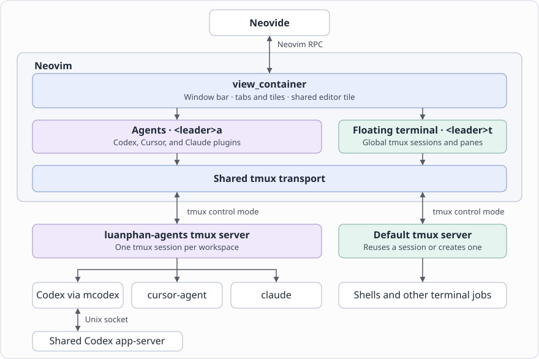
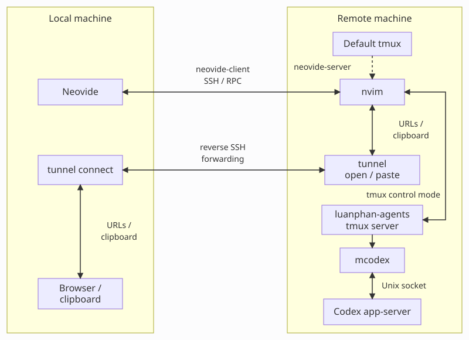

# workspace

- Shared shell tools, Git worktrees, Neovim, Neovide, Codex, and tmux.
- Components run independently and connect through workspace files, working directories, or client/server connections.

## Setup

```sh
make setup
exec zsh -l
make help
```

- **Tools:** Nix pins dependencies; the Makefile installs configurations and agent CLIs.
- **Skills:** Install separately with `make skills-sync`.
- **Configuration:** Edit files here, then run `make workspace-bin`, `make nvim-config`, `make neovide-config`, or `make tmux-config`.
- **Linux:** Run setup as your normal user. Fresh installations use single-user Nix; when `/nix` is missing, its installer uses `sudo` to create it. Reuse shared installations without changing ownership.
- **macOS:** Uses the Nix daemon installer.
- **Desktop automation:** Install: `make ardia hammerspoon`. Grant Accessibility access, then reload config. `Cmd-Shift-J/E/X` toggle terminal/editor/browser. The terminal toggle returns to the previous app. Sidebar Back/Forward: switch profiles (depends on browser session format). Edit `hammerspoon/init.lua` and apply with `make hammerspoon-config`.
- **Shell:** Setup keeps your login shell without administrator access. Run `exec zsh -l` to start the installed shell.
- **npm:** `make workspace-bin` configures global installs under `~/.local`, with commands in `~/.local/bin` on PATH. Install global tools with `npm install -g <package>` as your normal user. Existing global packages must be reinstalled to move them. Project dependencies remain local; run their tools through npm scripts or `npx`.

## Local workspaces

- Run [`mkws`](bin/mkws) from a folder containing direct repositories or repositories grouped one folder deep to create one Git worktree per selected repository:

```sh
mkws --name example-a --branch example-branch-a --add repo-a repo-b
mkws --name example-b --branch example-branch-b --add repo-b front-end/repo-c@example-branch-c
```

```text
<root>/
├── repo-a/
├── repo-b/
├── front-end/
│   └── repo-c/
└── local_workspaces/
    ├── example-a/
    │   ├── workspace.yml
    │   ├── tech_doc/
    │   ├── repo-a/    # example-branch-a
    │   └── repo-b/    # example-branch-a
    └── example-b/
        ├── workspace.yml
        ├── tech_doc/
        ├── repo-b/    # example-branch-b
        └── front-end/
            └── repo-c/    # example-branch-c
```

- Worktrees have separate working files and share history with their source repositories.
- `repo@branch` overrides the workspace's default branch for that repository.
- `workspace.yml` records each repository's root-relative path and branches; existing direct repository names remain valid. `tech_doc/` holds shared notes.
- `mkws resume` restores missing worktrees when the source repositories exist.
- **Neovim navigation:** Space is `<leader>`. Use `<leader>wp` for workspaces, `<leader>wr` for repositories, and `<leader>ww` for windows in the active agent or terminal view. Use `:WorktreeSwitch` for Git worktrees.

## Neovim architecture



- [`view_container`](nvim/lua/luanphan/view_container) owns panel lifecycle, layout, focus, the sidebar, and the editor tile. The shared tmux backend runs processes and keeps terminal history. Each panel supplies its commands and sidebar data.
- `<leader>a` opens workspace agents. In visual mode it sends the selection to an agent. The [Codex, Cursor, and Claude plugins](nvim/lua/luanphan/agents/plugins) supply their own launch and session behavior. Codex uses [`mcodex`](bin/mcodex) to connect its TUI to a shared Codex app-server. Each workspace has a session on `luanphan-agents`, with one tmux window per agent tile.
- `<leader>t` opens the global floating terminal. By default it reuses a session on the default tmux server or creates one if needed. It renders tmux panes as Neovim tabs or tiles. Hiding either floating panel keeps its jobs running.
- In a terminal tile in either floating panel, `:q` closes that tile and terminates its process. In an editor tile, `:q` closes the editor tile.
- `<leader>-t` opens the docked terminal for the current working directory. It uses Neovim terminal jobs.

## tmux as the glue

- Groups editors, agents, tests, and logs, keeping processes running across terminal disconnects.
- Run `nvim` and `mcodex` in separate panes, or use Neovide alongside them. New panes inherit the current directory.
- `Ctrl-b w` opens the tmux window picker. Use `tmux -L luanphan-agents attach` to attach to the agent server directly.

## Remote development



```sh
# Remote machine, from the workspace directory:
tmux new-session -s example-workspace
neovide-server 6666

# Local machine:
neovide-client example-host:6666

# Separate local terminal, for browser and clipboard forwarding:
tunnel connect example-host
```

- **Editor:** The client attaches local Neovide over SSH to remote headless Neovim. Files and agent jobs stay remote.
- **Lifetime:** Disconnecting the GUI leaves the hosted editor available; quitting Neovim ends it. The Codex daemon runs separately.
- **Tunnel:** The separate [`tunnel`](bin/tunnel) connection opens remote URLs locally and transfers copied files or images to the remote machine.
