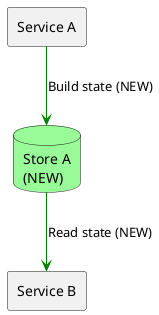

# Markdown Flowcharts

## Source

Build PlantUML flowcharts from verified graph produced during code exploration. Keep chat and document diagrams on same nodes and edges.

Put every diagram in a `plantuml` fence. Start with `@startuml` and end with `@enduml`.

## Architecture flowchart

- Show only the primary nodes needed for the changed flow; do not pad a simple diagram to meet a node count.
- Default to `top to bottom direction`.
- Use `left to right direction` only for one linear path with at most five primary nodes, no branches, merges, or shared stores, short edge labels, and a readable preview at normal document width.
- Use `top to bottom direction` for multiple paths, branches, shared stores, or long labels.
- If a top-down diagram is still too wide, split unrelated flows. Use concern or phase subgraphs only when they improve grouping, never only to control layout.
- Keep each label line within 40 characters. Insert line breaks at meaningful phrase or syntax boundaries; never split a word arbitrarily.
- Give every node a stable alias. Connect every branch and merge explicitly.
- Move operation detail into short edge labels or split the flow into another flowchart when the overview becomes noisy.

Mark new nodes and edges with `(NEW)`:

## Review

- Preview and visually inspect every changed diagram at normal document width.
- Remove articles and connective words from labels when meaning stays clear.
- Verify every rendered label line is at most 40 characters and each break preserves meaning.
- If labels require zooming or horizontal scrolling, change the diagram to top-down or split it.
- Every drawn edge has code or contract evidence.
- Shared nodes are not duplicated.
- The requested behavior is visible without explanatory prose.
- New behavior carries `(NEW)` on affected nodes and edges.
- Diagram labels contain no information repeated below the diagram.
