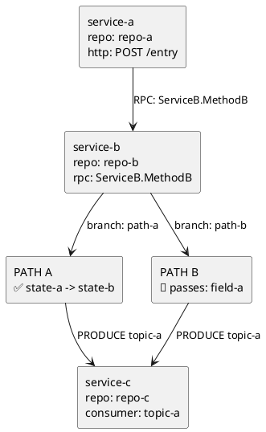

# PlantUML Diagrams

Keep labels identifier-led. Remove articles and connective words when meaning stays clear.

## Output contract

- Start the answer with exactly one merged diagram in a top-level `plantuml` fence.
- Start with `@startuml` and end with `@enduml`.
- Use `🔷` for requested identifier or value, `✅` for confirmed mutation, and `⚠️` for missing or unproven propagation.
- Follow the diagram with ordered `path:line` evidence. Add at most three bullets for behavior not visible in the graph.

## Graph model

Normalize each cross-boundary edge as:

`(source, protocol, operation/path/topic, target, evidence path:line)`

- Trace upstream callers and downstream effects into one graph.
- Reuse one node for the same service or component. Merge shared paths and convergence; do not render one chart per branch.
- Keep nodes at service and entrypoint level. Include private helpers only when the user asks about their internal logic.
- A single-entrypoint service uses one box with `repo:` plus `rpc:`, `http:`, `consumer:`, or `method:`.
- Use nested operation boxes only when multiple same-level entrypoints in one service matter.
- Use standalone logic boxes for important branches, validation, mutation, or filtering inside one entrypoint.
- Label every cross-node edge with the exact protocol and operation: RPC method, HTTP method/path, SQL operation/table, cache command/key, or message topic.
- Put unproven targets in one `Disconnected / evidence not found` box. Mark read-only external evidence with `external: yes`.

## Focus trace

Use the user's actual identifier, not a generic `FOCUS` label:

- `request: <identifier>`
- `value: <observed value>`
- `mutates: <before> -> <after>`
- `passes: <identifier>`
- `missing: <identifier>`

Use `🔷`, `✅`, and `⚠️` only where emphasis changes how graph is read. Put swatch immediately before text it describes.

## Layout

- Use `top to bottom direction` by default.
- Give every node a stable alias and connect arrows to exact operation or logic node they trigger.
- Use `together` only when keeping same-depth nodes together improves readability.
- Wrap long labels with `\n` at meaningful boundaries.
- A branch is incomplete unless every target has a connected arrow.

