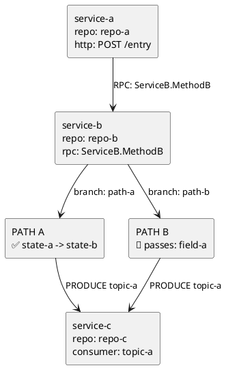

# Code Graphs

Keep labels identifier-led. Remove articles and connective words when meaning stays clear.

## Output contract

- Start exploration answers with exactly one merged diagram. Reviews keep findings first.
- Follow [../SKILL.md](../SKILL.md#diagrams) for destination format: terminal/TUI replies and chat without known rendering support use text graphs in a `text` fence; document diagrams use PlantUML. Explicit requests for diagram source override this default.
- Use `🔷` for requested identifier or value, `✅` for confirmed mutation, and `⚠️` for missing or unproven propagation, including in terminal/TUI graphs.
- Follow the diagram with ordered `path:line` evidence. Add at most three bullets for behavior not visible in the graph.

## Graph model

Normalize each cross-boundary edge as:

`(source, protocol, operation/path/topic, target, evidence path:line)`

- Trace upstream callers and downstream effects into one graph.
- Reuse one node for the same service or component. Merge shared paths and convergence; do not render one chart per branch.
- Keep nodes at service and entrypoint level. Include private helpers only when the user asks about their internal logic.
- A single-entrypoint service uses one box with `repo:` plus `rpc:`, `http:`, `consumer:`, or `method:`.
- Use nested operation boxes only when multiple same-level entrypoints in one service matter.
- Use standalone logic boxes for important branches, validation, mutation, or filtering inside one entrypoint.
- Label every cross-node edge with the exact protocol and operation: RPC method, HTTP method/path, SQL operation/table, cache command/key, or message topic.
- Put unproven targets in one `Disconnected / evidence not found` box. Mark read-only external evidence with `external: yes`.

## Focus trace

Use the user's actual identifier, not a generic `FOCUS` label:

- `request: <identifier>`
- `value: <observed value>`
- `mutates: <before> -> <after>`
- `passes: <identifier>`
- `missing: <identifier>`

Use `🔷`, `✅`, and `⚠️` only where emphasis changes how graph is read. Put swatch immediately before text it describes.

## Layout

- Text graphs use box-drawing borders around nodes, connected arrows, and explicit branch/merge connectors. Keep 🔷 ✅ ⚠️ highlights, edge labels, and shared targets. Do not replace boxes with indented lists or bare arrow chains; do not include PlantUML commands or escaped newlines.
- PlantUML layout rules below apply only to PlantUML output.
- Use `top to bottom direction` by default.
- Give every node a stable alias and connect arrows to exact operation or logic node they trigger.
- Use `together` only when keeping same-depth nodes together improves readability.
- Wrap long labels with `\n` at meaningful boundaries.
- A branch is incomplete unless every target has a connected arrow.

Terminal example:

```text
                 ┌────────────────────────────┐
                 │ service-a                  │
                 │ repo: repo-a               │
                 │ http: POST /entry          │
                 └────────────────────────────┘
                                │ RPC: ServiceB.MethodB
                                ▼
                 ┌────────────────────────────┐
                 │ service-b                  │
                 │ repo: repo-b               │
                 │ rpc: ServiceB.MethodB      │
                 └────────────────────────────┘
                                │
               ┌────────────────┴────────────────┐
               │ branch: path-a                  │ branch: path-b
               ▼                                 ▼
┌────────────────────────────┐    ┌────────────────────────────┐
│ PATH A                     │    │ PATH B                     │
│ ✅ state-a -> state-b      │    │ 🔷 passes: field-a         │
└────────────────────────────┘    └────────────────────────────┘
               │ PRODUCE topic-a                 │ PRODUCE topic-a
               └────────────────┬────────────────┘
                                ▼
                 ┌────────────────────────────┐
                 │ service-c                  │
                 │ repo: repo-c               │
                 │ consumer: topic-a          │
                 └────────────────────────────┘
```

Document/source example:


