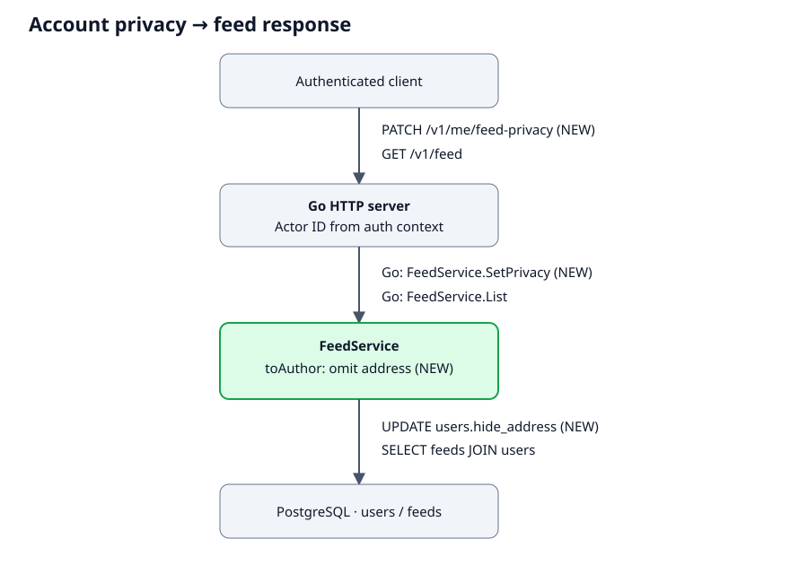

[toc]

# 1. Overview & Background

- `author.address`: user-controlled omission from feed responses.
- Account setting applies to existing and new feed items.

# 2. Links

- [Example requirement](https://example.com/specs/feed-privacy)

# 3. Solution Overview



# 5. External Technical Design

| API | Change |
| --- | --- |
| `PATCH /v1/me/feed-privacy` | New. Body `{"hide_address":true}`. `204` after persistence. |
| `GET /v1/feed` | `author.address` optional. Hidden value omitted. |

- `PATCH /v1/me/feed-privacy`:
  - Return `400` unless `hide_address` is boolean.
  - Use authenticated user ID.
  - Return `204` for same-value retries.

# 6. Internal Technical Design

## 6.1 Service: `example-api`

### Logic change

- `FeedService.SetPrivacy`:
  - Update only authenticated user's setting.
  - Default `false` preserves existing behavior.
- `FeedService.List`:
  - Join current author settings.
  - Build response with `toAuthor`.
  - Ignore addresses from snapshots and cached responses.
  - Fail request when author settings cannot be read.
  - Disable personalized response caching.
  - Previously downloaded addresses remain visible.

### Code changes

<details>
<summary><strong>Code change — hide_address (migrations/002_feed_privacy.sql)</strong></summary>

```sql
ALTER TABLE users
    ADD COLUMN hide_address boolean NOT NULL DEFAULT false;
```

</details>

<details>
<summary><strong>Code change — toAuthor (internal/feed/response.go)</strong></summary>

```diff
type AuthorRow struct {
    ID          string
    Address     string
+    HideAddress bool
}

type Author struct {
    ID      string  `json:"id"`
    Address *string `json:"address,omitempty"`
}

func toAuthor(row AuthorRow) Author {
-    return Author{ID: row.ID, Address: &row.Address}
+    author := Author{ID: row.ID}
+    if !row.HideAddress {
+        author.Address = &row.Address
+    }
    return author
}
```

- Route `PATCH /v1/me/feed-privacy` to `FeedService.SetPrivacy`.
- Select `users.hide_address` in feed query.
- Assert JSON `author.address` is absent.

</details>

# 7. Rollout Plan

1. Add `users.hide_address`.
2. Deploy `example-api` readers.
3. Expose privacy setting.

- Rollback: keep address filter after first opt-in.
