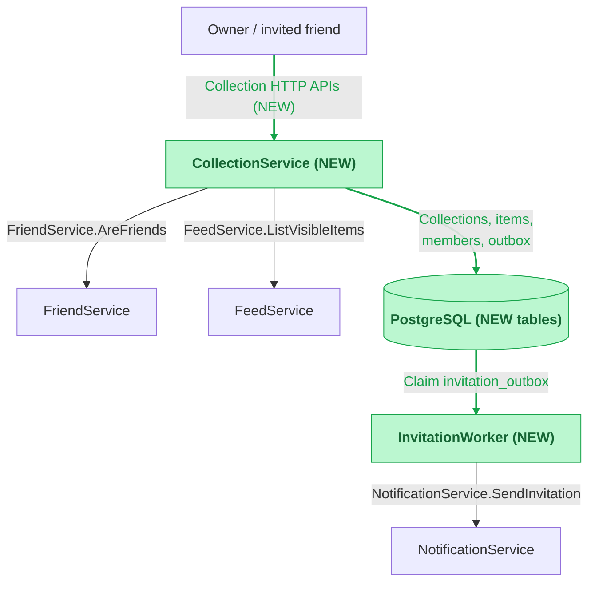
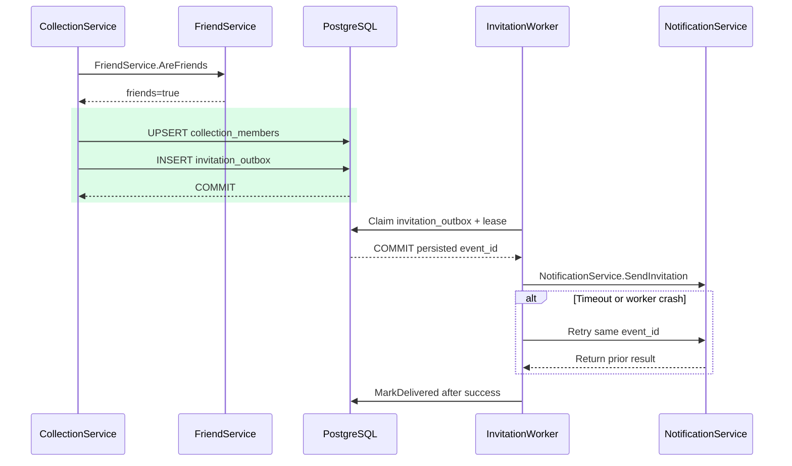

[toc]

# 1. Overview & Background

- Shared collections save feed items and support friend invitations.
- Active members see currently accessible items.
- Revocation blocks later reads.

# 2. Links

- [Example requirement](https://example.com/specs/shared-collections)

# 3. Solution Overview

## 3.1 Architecture



## 3.2 Membership states

| Current state | Operation | Next state |
| --- | --- | --- |
| No row | Owner invites friend | `pending`, version `1` |
| `pending` | Invited friend accepts current version | `active`, same version |
| `pending` / `active` | Owner removes member | `revoked`, version + `1` |
| `revoked` | Owner invites again | `pending`, version + `1` |

## 3.3 Invite and retry



# 4. Design Decisions

- Invite and accept:
  - Members consent before access.
  - Cost: extra acceptance step.
- Feed ID storage:
  - Current visibility and address-privacy rules remain authoritative.
  - Cost: reads depend on `FeedService`.

# 5. External Technical Design

- Authentication supplies actor ID.
- IDs are opaque strings.
- Unauthorized collection access returns `404`.

| API | Request | Success |
| --- | --- | --- |
| `POST /v1/collections` | `Idempotency-Key`, `{"name":"Weekend","feed_ids":["f1","f2"]}` | `201 {"id":"c1"}`. Retry returns same ID. |
| `PUT /v1/collections/{id}/items/{feed_id}` | Owner, no body | `204`. Existing item unchanged. |
| `PUT /v1/collections/{id}/members/{user_id}` | Owner invites friend, no body | `200 {"state":"pending","version":1}`. Existing pending/active state unchanged. |
| `POST /v1/collections/{id}/membership/accept` | `{"version":1}`, invited actor only | `200 {"state":"active","version":1}`. |
| `DELETE /v1/collections/{id}/members/{user_id}` | Owner, no body | `204`. Absent/revoked member unchanged. |
| `GET /v1/collections/{id}/items` | Optional opaque `cursor`, at most 50 items | `200 {"items":[],"next_cursor":null}`. |

- Validation:
  - Require names with 1–80 characters.
  - Accept 1–100 distinct feed IDs in `Create`.
- Errors:
  - Return `400` for invalid input.
  - Return `404` for inaccessible feeds.
  - Return `409` for stale invite versions or changed payload under same idempotency key.
  - Return `503` for dependency failures without allowing read or committing write.

# 6. Internal Technical Design

## 6.1 Service: `CollectionService`

### Logic change

- `Create` / `AddItem`:
  - Validate item access with `FeedService.ListVisibleItems`.
  - Store feed IDs only.
  - `Create`:
    - Store normalized payload hash and result in one transaction under `(owner_id, request_key)`.
    - Return stored result for matching retries.
- `Invite` / `Accept` / `RemoveMember`:
  - `Invite`:
    - Require ownership and `FriendService.AreFriends`.
    - Lock collection; write membership and outbox row in one transaction.
    - Skip insert for pending or active retries.
  - `Accept`:
    - Recheck friendship.
    - Require current invite version.
  - `RemoveMember`:
    - Use collection lock to prevent concurrent `Accept` from restoring access.
- `ListItems`:
  - Allow owner or active member with current friendship.
  - Call `FeedService.ListVisibleItems` with viewer ID.
  - Apply item visibility and address privacy at read time.
  - Use bounded keyset cursor at last scanned item.
  - Omit deleted or inaccessible items.

### Code changes

<details>
<summary><strong>Code change — collection storage (migrations/003_collections.sql)</strong></summary>

```sql
CREATE TABLE collections (
    id text PRIMARY KEY,
    owner_id text NOT NULL,
    name text NOT NULL,
    request_key text NOT NULL,
    request_hash text NOT NULL,
    UNIQUE (owner_id, request_key)
);
CREATE TABLE collection_items (
    collection_id text NOT NULL REFERENCES collections(id),
    feed_id text NOT NULL,
    added_at timestamptz NOT NULL DEFAULT now(),
    PRIMARY KEY (collection_id, feed_id)
);
CREATE TABLE collection_members (
    collection_id text NOT NULL REFERENCES collections(id),
    user_id text NOT NULL,
    state text NOT NULL CHECK (state IN ('pending', 'active', 'revoked')),
    version bigint NOT NULL CHECK (version > 0),
    PRIMARY KEY (collection_id, user_id)
);
CREATE TABLE invitation_outbox (
    event_id text PRIMARY KEY,
    collection_id text NOT NULL REFERENCES collections(id),
    user_id text NOT NULL,
    version bigint NOT NULL,
    delivered_at timestamptz,
    cancelled_at timestamptz,
    next_attempt_at timestamptz NOT NULL DEFAULT now(),
    attempts integer NOT NULL DEFAULT 0,
    UNIQUE (collection_id, user_id, version)
);
CREATE INDEX collection_items_page
    ON collection_items (collection_id, added_at, feed_id);
CREATE INDEX invitation_outbox_due
    ON invitation_outbox (next_attempt_at)
    WHERE delivered_at IS NULL AND cancelled_at IS NULL;
```

- Membership mutations:
  - Use `SELECT collections ... FOR UPDATE`.
  - Update acceptance with `WHERE state='pending' AND version=$expected`.
  - Return success for same active-version retry.
- Item storage:
  - Write with `ON CONFLICT DO NOTHING`.
  - Order list and cursor by `(added_at, feed_id)` with matching index.
- Creation conflicts:
  - Return stored hash and result.

</details>

## 6.2 Service: `InvitationWorker`

### Logic change

- `ClaimDue`:
  - Poll due outbox rows.
  - Claim with `FOR UPDATE SKIP LOCKED`.
  - Increment `attempts` in claim transaction.
  - Set `next_attempt_at` to lease deadline in same transaction.
  - Send after commit.
- `NotificationService.SendInvitation`:
  - Call `POST /internal/notifications/invitations`.
  - Deduplicate by `event_id`.
  - Retry same ID with capped backoff after lost acknowledgement or worker crash.
  - Set `delivered_at` only after success.
- Pending delivery:
  - Grant access only after acceptance.
  - Set `cancelled_at` for revoked or superseded versions.
  - Acceptance checks current state if revocation races delivery.
  - Alert on oldest unprocessed event.
  - Keep event after retry exhaustion.

### Config changes

#### `worker.yaml` (service: `InvitationWorker`)

- Namespace/key: `delivery.retry` (`delays_seconds`, `lease_seconds`).
- `Retry` reuses final delay after configured sequence.

```diff
delivery:
  batch_size: 100
  retry:
    delays_seconds:
      - 5
      - 30
      - 300
+      - 900
+    lease_seconds: 60
  ...
```

# 7. Rollout Plan

1. Apply tables and indexes.
2. Deploy `InvitationWorker` with polling disabled.
3. Deploy `CollectionService` once dependency contracts are available.
4. Enable polling and collection actions.
5. Verify create → invite → accept → read.

- Rollback: disable writes, retain membership checks and outbox rows.
