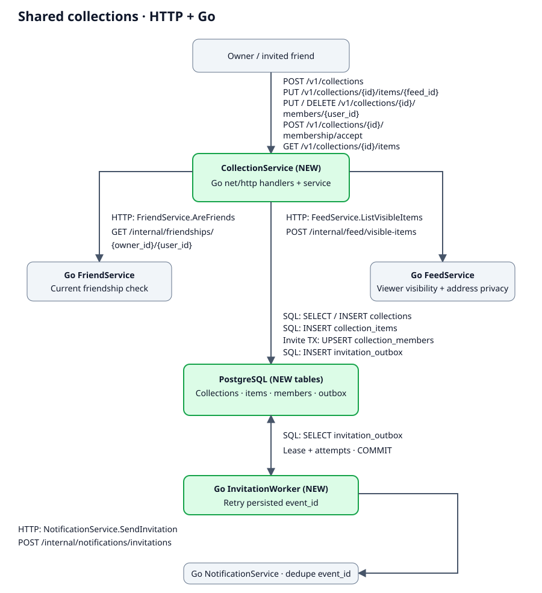
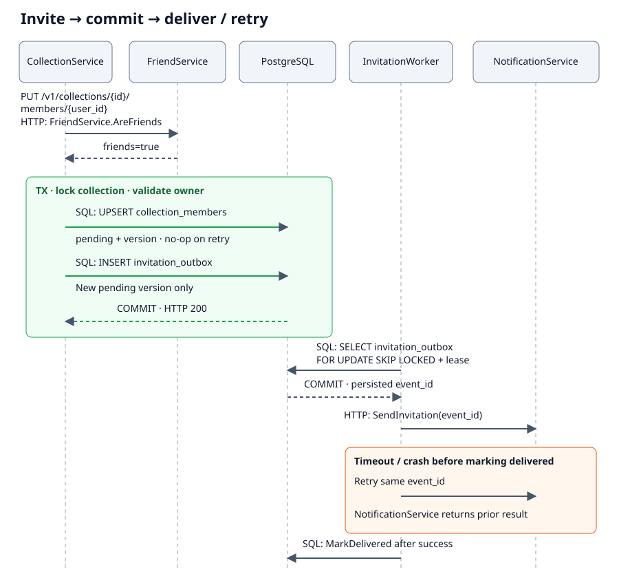

[toc]

# 1. Overview & Background

- Let a user save feed items in a collection and invite friends to follow it.
- Target:
  - Followers see current accessible items.
  - Removing access stops later reads.
- Fictional example:
  - A Go HTTP `CollectionService`, existing Go HTTP friend/feed/notification services, PostgreSQL, and a Go invitation worker.
  - Paths below are illustrative.

# 2. Links

- [Example requirement](https://example.com/specs/shared-collections)

# 3. Solution Overview

## 3.1 Architecture



## 3.2 Membership states

| Current state | Operation | Next state |
| --- | --- | --- |
| No row | Owner invites a friend | `pending`, version `1` |
| `pending` | Invited friend accepts the current version | `active`, same version |
| `pending` / `active` | Owner removes the member | `revoked`, version + `1` |
| `revoked` | Owner invites again | `pending`, version + `1` |

## 3.3 Invite and retry



# 4. Design Decisions

- Invite-and-accept instead of automatic following:
  - Friends explicitly consent to joining the collection.
  - Access requires an extra acceptance step.
- Store feed IDs instead of content snapshots:
  - Current visibility and address-privacy rules remain authoritative.
  - Collection reads depend on `FeedService` availability.

# 5. External Technical Design

- Authentication supplies the actor ID for every API.
- IDs are opaque strings.
- Unauthorized collection access returns `404`.

| API | Request | Success |
| --- | --- | --- |
| `POST /v1/collections` | `Idempotency-Key` header; `{"name":"Weekend","feed_ids":["f1","f2"]}` | `201 {"id":"c1"}`; retries return the same ID. |
| `PUT /v1/collections/{id}/items/{feed_id}` | No body; owner only | `204`; existing item is a no-op. |
| `PUT /v1/collections/{id}/members/{user_id}` | No body; owner invites a friend | `200 {"state":"pending","version":1}`; existing pending/active state is a no-op. |
| `POST /v1/collections/{id}/membership/accept` | `{"version":1}`; invited actor only | `200 {"state":"active","version":1}`. |
| `DELETE /v1/collections/{id}/members/{user_id}` | No body; owner only | `204`; absent/revoked member is a no-op. |
| `GET /v1/collections/{id}/items` | Optional opaque `cursor`; at most 50 items | `200 {"items":[],"next_cursor":null}`. |

- Validation:
  - Names are 1–80 characters.
  - Create accepts 1–100 distinct feed IDs.
- Errors:
  - Invalid input returns `400`.
  - An inaccessible feed returns `404`.
  - A stale invite version or changed create payload under the same key returns `409`.
  - Dependency failures return `503` without allowing the read or committing the write.

# 6. Internal Technical Design

## 6.1 Service: `CollectionService`

### Logic change

- `Create` / `AddItem`:
  - Validate item access through `FeedService.ListVisibleItems`.
  - Store feed IDs only.
  - `Create` stores the canonical payload hash and result under `(owner_id, request_key)` in the same transaction.
  - Matching create retries reuse the result.
- `Invite` / `Accept` / `RemoveMember`:
  - `Invite` requires ownership and `FriendService.AreFriends`.
  - `Invite` locks the collection, then writes membership and the outbox row in one transaction.
  - Pending/active invitation retries insert nothing.
  - `Accept` rechecks friendship.
  - `Accept` requires the current invite version.
  - `RemoveMember` uses the same collection lock to prevent concurrent acceptance from restoring revoked access.
- `ListItems`:
  - Allow the owner or an active member who is still a friend.
  - Call `FeedService.ListVisibleItems` with the viewer ID.
  - Apply item visibility and address privacy at read time.
  - Use a bounded keyset cursor pointing to the last scanned item.
  - Omit deleted/inaccessible items instead of returning stored content.

### Code changes

<details>
<summary><strong>Code change — collection storage (migrations/003_collections.sql)</strong></summary>

```sql
CREATE TABLE collections (
    id text PRIMARY KEY,
    owner_id text NOT NULL,
    name text NOT NULL,
    request_key text NOT NULL,
    request_hash text NOT NULL,
    UNIQUE (owner_id, request_key)
);
CREATE TABLE collection_items (
    collection_id text NOT NULL REFERENCES collections(id),
    feed_id text NOT NULL,
    added_at timestamptz NOT NULL DEFAULT now(),
    PRIMARY KEY (collection_id, feed_id)
);
CREATE TABLE collection_members (
    collection_id text NOT NULL REFERENCES collections(id),
    user_id text NOT NULL,
    state text NOT NULL CHECK (state IN ('pending', 'active', 'revoked')),
    version bigint NOT NULL CHECK (version > 0),
    PRIMARY KEY (collection_id, user_id)
);
CREATE TABLE invitation_outbox (
    event_id text PRIMARY KEY,
    collection_id text NOT NULL REFERENCES collections(id),
    user_id text NOT NULL,
    version bigint NOT NULL,
    delivered_at timestamptz,
    cancelled_at timestamptz,
    next_attempt_at timestamptz NOT NULL DEFAULT now(),
    attempts integer NOT NULL DEFAULT 0,
    UNIQUE (collection_id, user_id, version)
);
CREATE INDEX collection_items_page
    ON collection_items (collection_id, added_at, feed_id);
CREATE INDEX invitation_outbox_due
    ON invitation_outbox (next_attempt_at)
    WHERE delivered_at IS NULL AND cancelled_at IS NULL;
```

- Membership mutations:
  - Use `SELECT collections ... FOR UPDATE`.
  - Accept uses `WHERE state='pending' AND version=$expected`.
  - A retry of the same active version succeeds.
- Item storage:
  - Writes use `ON CONFLICT DO NOTHING`.
  - List order/cursor is `(added_at, feed_id)`, with a matching index.
- Creation conflicts:
  - Reload the stored hash/result instead of creating another collection.

</details>

<details>
<summary><strong>Code change — HTTP routes (internal/http/routes.go)</strong></summary>

```go
func registerCollectionRoutes(mux *http.ServeMux, h *CollectionHandlers) {
    mux.HandleFunc("POST /v1/collections", h.Create)
    mux.HandleFunc("PUT /v1/collections/{id}/items/{feed_id}", h.AddItem)
    mux.HandleFunc("PUT /v1/collections/{id}/members/{user_id}", h.Invite)
    mux.HandleFunc("POST /v1/collections/{id}/membership/accept", h.Accept)
    mux.HandleFunc("DELETE /v1/collections/{id}/members/{user_id}", h.RemoveMember)
    mux.HandleFunc("GET /v1/collections/{id}/items", h.ListItems)
}
```

- HTTP handlers:
  - Use existing auth/JSON/error helpers.
  - Delegate to the matching `CollectionService` method.
- Service clients:
  - `FriendService.AreFriends` uses `GET /internal/friendships/{owner_id}/{user_id}`.
  - `FeedService.ListVisibleItems` uses `POST /internal/feed/visible-items` with `viewer_id` and ordered `feed_ids`.
  - Authenticate both service-to-service calls.
  - Never accept the viewer identity from a public body.

</details>

## 6.2 Service: `InvitationWorker`

### Logic change

- `ClaimDue`:
  - Poll due, unprocessed outbox rows.
  - Claim with `FOR UPDATE SKIP LOCKED`.
  - Increment `attempts` in the claim transaction.
  - Move `next_attempt_at` to the lease deadline in that transaction.
  - Send after commit, outside the claim transaction.
- `NotificationService.SendInvitation`:
  - Use `POST /internal/notifications/invitations`.
  - Deduplicate by `event_id`.
  - Retry the same ID with capped backoff after lost acknowledgements or worker crashes.
  - Mark `delivered_at` only after success.
- Pending delivery:
  - Never grant access before acceptance.
  - Set `cancelled_at` for revoked/superseded versions.
  - Acceptance checks current state if revocation races delivery.
  - Alert on the oldest unprocessed event.
  - Never drop an invite merely because retries were exhausted.

### Code changes

<details>
<summary><strong>Code change — processOne (internal/invitations/worker.go)</strong></summary>

```go
func (w *Worker) processOne(ctx context.Context) error {
    event, err := w.store.ClaimDue(ctx)
    if err != nil {
        return err
    }
    current, err := w.store.IsCurrentPendingInvite(ctx, event)
    if err != nil {
        return w.store.Retry(ctx, event, err)
    }
    if !current {
        return w.store.Cancel(ctx, event.ID)
    }
    if err := w.notifications.SendInvitation(ctx, event); err != nil {
        return w.store.Retry(ctx, event, err)
    }
    return w.store.MarkDelivered(ctx, event.ID)
}
```

- `ClaimDue` persists the lease.
- `Retry` persists the backoff deadline.
- `SendInvitation` forwards the persisted `event_id` as its idempotency key.
- Poll-loop, client and store helpers follow existing patterns.

</details>

# 7. Rollout Plan

1. Apply tables/indexes and deploy the worker with polling disabled.
2. Deploy collection APIs after the authenticated friend/feed/notification contracts are available.
3. Enable polling and expose collection actions; disable new writes on rollback, retain membership checks and outbox rows.

# 8. Release Checklist

- [ ] Apply schema/indexes and deploy the server and worker.
- [ ] Enable polling and verify one create → invite → accept → read flow.
- [ ] Verify stale acceptance, removed friends, duplicate requests and delivery retries do not grant access or duplicate notifications.
