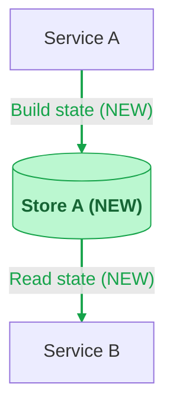

# Markdown Flowcharts

## Source

Build flowcharts from verified graph produced during code exploration. Keep terminal and document diagrams on same nodes and edges.

Use only flowcharts in Markdown documents. Markdown preview requires code fence language `mermaid`; start body with `flowchart TB` or `flowchart LR`. Never use sequence, class, state, entity-relationship, or another diagram grammar.

## Architecture flowchart

- Show only the primary nodes needed for the changed flow; do not pad a simple diagram to meet a node count.
- Default to `flowchart TB`.
- Use `flowchart LR` only for one linear path with at most five primary nodes, no branches, merges, or shared stores, short edge labels, and a readable render at normal document width.
- Use `flowchart TB` for multiple paths, branches, shared stores, or long labels.
- If a top-down diagram is still too wide, split unrelated flows. Use concern or phase subgraphs only when they improve grouping, never only to control layout.
- Keep node IDs simple. Put punctuation, paths, operation names, and `(NEW)` inside quoted labels.
- Keep each rendered label line within 40 characters. Insert line breaks at meaningful phrase or syntax boundaries; never split a word arbitrarily.
- Quote edge labels containing punctuation or paths.
- Keep one flowchart statement per line.
- Move operation detail into short edge labels or split the flow into another flowchart when the overview becomes noisy.

Mark new nodes and edges with `(NEW)` and green styling:

## Review

- Render and visually inspect every changed diagram at normal document width; a successful syntax check is insufficient.
- Remove articles and connective words from labels when meaning stays clear.
- Verify every rendered label line is at most 40 characters and each break preserves meaning.
- If labels require zooming or horizontal scrolling, change the diagram to top-down or split it.
- Every drawn edge has code or contract evidence.
- Shared nodes are not duplicated.
- The requested behavior is visible without explanatory prose.
- New and existing behavior are visually distinct.
- Diagram labels contain no information repeated below the diagram.
